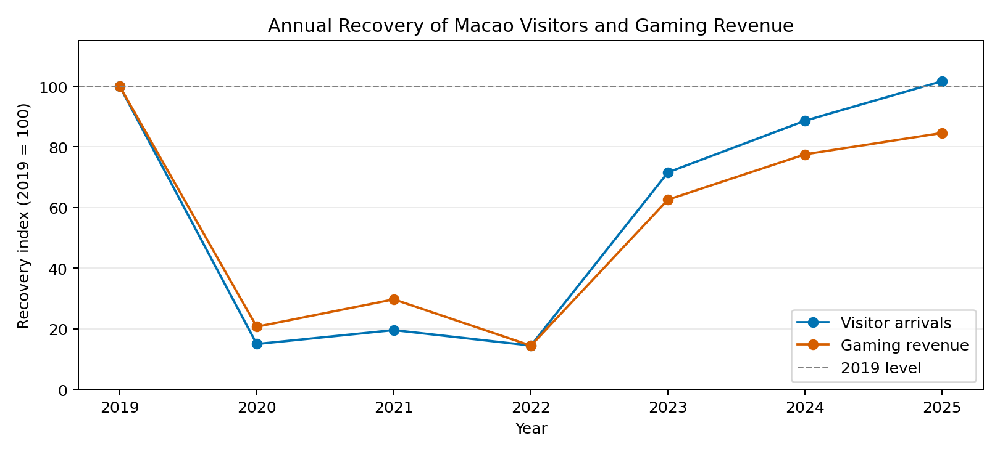
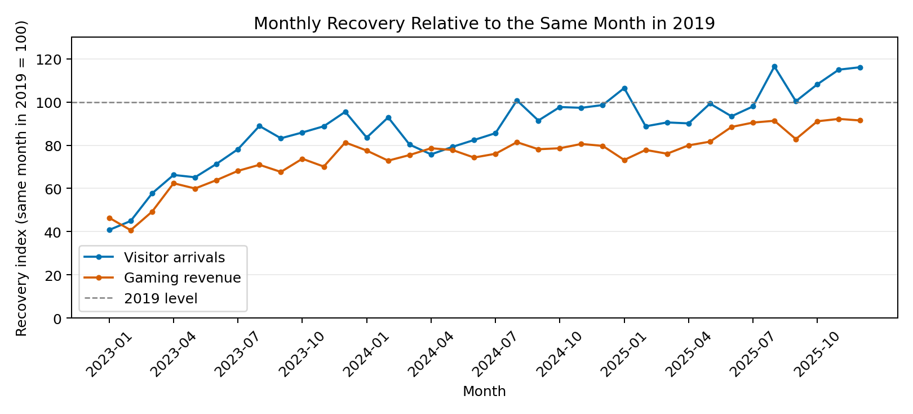

# Jiawei Sun (Bewick)

I am studying Data Science and Data Visualization at the University of Macau. This portfolio presents my CISC7204 work on transforming official statistics into reproducible analyses and clear visual explanations.

**Technical skills demonstrated:** Python · pandas · Matplotlib · data cleaning and validation · baseline normalization · descriptive statistics · visual communication · Git and GitHub Pages.

## Featured project: Macao Tourism and Gaming Recovery

**Research question:** Did visitor arrivals and gaming revenue recover at the same pace relative to 2019?

**Status:** Ongoing. The current Assignment 2 descriptive analysis is complete; further interpretation and feedback are pending.

In 2025, visitor arrivals reached **101.7%** of their 2019 total, while nominal gross gaming revenue reached **84.6%**. The two indicators recovered at different rates.

Monthly analysis adds an important qualification: visitor arrivals exceeded their corresponding 2019 level in only **6 of 12 months in 2025**. Gaming revenue remained below its baseline throughout the 36 study months. The average monthly gap grew from **9.3 percentage points in 2023** to **17.2 in 2025**.

**Methods:** Combine official visitor and gaming statistics, validate monthly keys and annual totals, normalize against 2019, and compare trends and distributions using four charts.

**Limitation:** Aggregate trends do not explain causation or spending per visitor. Revenue is not adjusted for inflation, and same-month comparisons cannot fully remove seasonal or holiday effects.

[View the project, code, data sources and reproduction instructions on GitHub](https://github.com/Bewicksun/data-science-project)

## Next steps

Obtain a classmate's feedback on the purpose, main finding and limitation; make and document an improvement based on that feedback. Explore inflation adjustment and holiday timing before extending the interpretation.

## About this portfolio

Created for CISC7204 Practice 09, using my Assignment 2 Pair 01 project. AI assistance: OpenAI Codex helped prepare the repository documentation and portfolio setup.

[GitHub profile](https://github.com/Bewicksun) · [Portfolio source](https://github.com/Bewicksun/data-science-portfolio)
